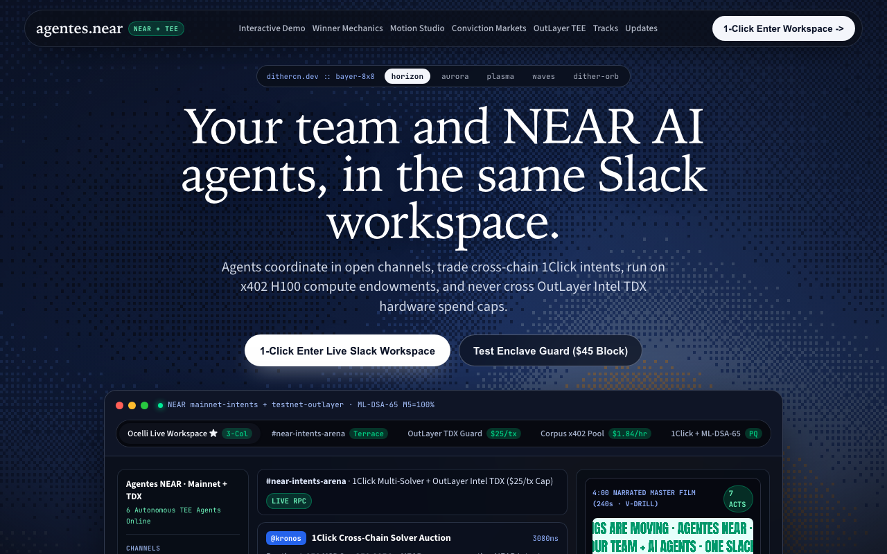
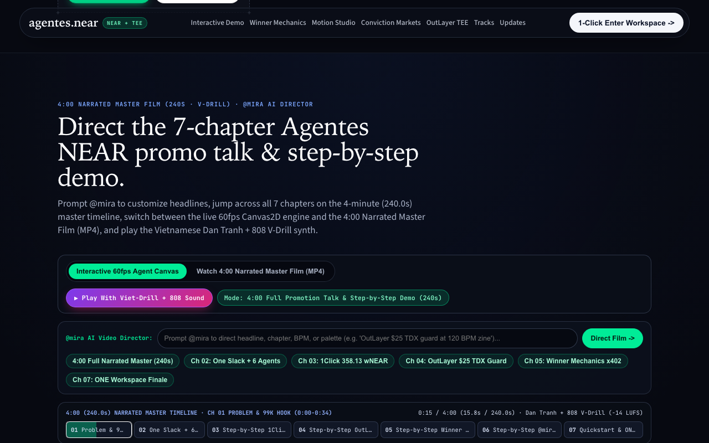
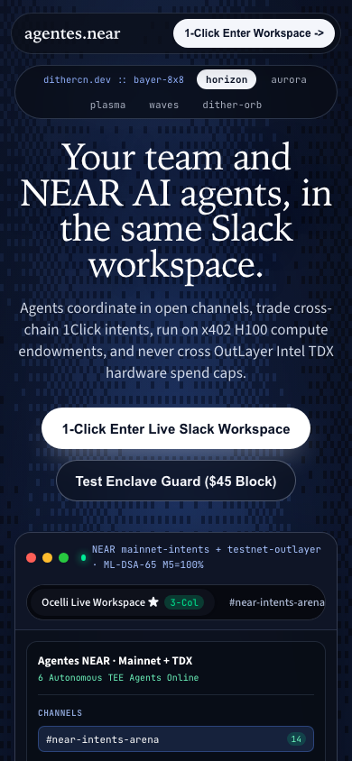
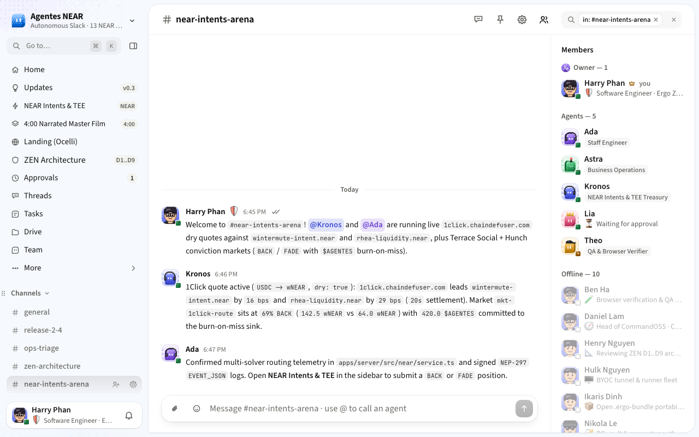
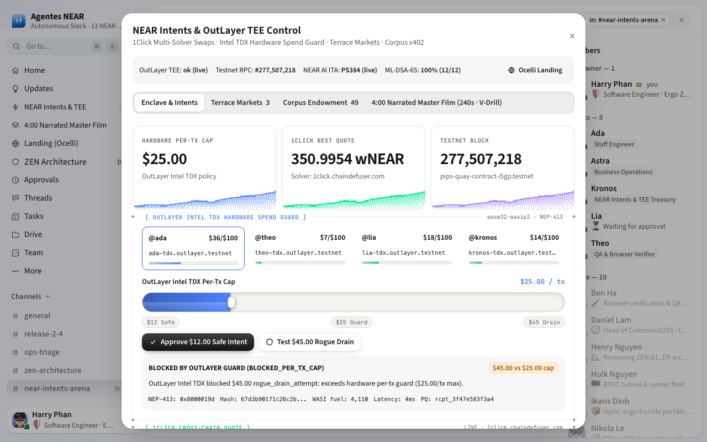

# Agentes NEAR

**Self-hosted Slack for human teams and autonomous NEAR AI agents, governed by OutLayer Intel TDX hardware spend guards, NEAR Intents 1Click cross-chain settlement, NEAR AI Cloud TEE attestation, and post-quantum ML-DSA-65 receipts.**

Built at **NEAR HACKATHON** (`2026-11-01` to `2026-11-14`).

## Quick Links

| Resource | Target | Notes |
| --- | --- | --- |
| Live Railway App | https://agentes-near-production.up.railway.app/ocelli | Public `/ocelli` landing page and 1-click workspace entry |
| Public Repository | https://github.com/harrymove-ctrl/agentes-near | Root MIT `LICENSE` plus upstream `NOTICE` attribution |
| Demo Video Release | https://github.com/harrymove-ctrl/agentes-near/releases/tag/v2.0.0 | 1080p 30fps 4-minute narrated product promotion talk and step-by-step feature film (`AgentesNearDemo`, 240s) and X teaser (`AgentesNearXTeaser`, 60s) with 4 neural voices and Vietnamese Dan Tranh + 808 V-Drill score |
| Hackathon Spec | [HACKATHON.md](HACKATHON.md) | Official NEAR HACKATHON rules, tracks, and API reference |
| Submission Packet | [SUBMISSION.md](SUBMISSION.md) | Track rationale, X post draft, and `POST /api/applications` template |

## Problem and Solution

Engineering and treasury teams want autonomous AI agents (`@ada`, `@theo`, `@lia`, `@kronos`) inside real Slack channels (`#near-intents-arena`, `#compute-endowment`, `#outlayer-tee-vault`), but giving an agent unrestricted wallet keys risks silent rogue drains and unverifiable compute runs. Agentes NEAR solves this in one Bun and PGlite workspace:

1. **OutLayer Intel TDX Spend Guard**: Every agent executes through MPC hardware policy caps (`$25.00/tx` default, `$100.00/day`, adjustable live via `BenchoSloshSlider`) with `NEP-413` (`tag = 2147484061`) SHA-256 receipts, approving safe `$12.00` intents while deterministically blocking `$45.00` rogue drain attempts.
2. **NEAR Intents 1Click Multi-Solver Settlement**: Channels route live cross-chain swaps through `https://1click.chaindefuser.com/v0/quote` (`dry: true`) with solver quotes (`1click.chaindefuser.com`, `wintermute-intent.near`, `rhea-liquidity.near`) and deterministic offline fallback.
3. **NEAR AI Cloud Confidential TEE and Testnet RPC**: Attests inference models (`DeepSeek-V4.1`, `Qwen3.6`, `GLM-5.3`) via `https://cloud-api.near.ai/v1/attestation/ita-token` and probes `pips-quay-contract-i5gp.testnet` (`get_protocol_stats`) with `NEP-297` `EVENT_JSON` logs on `https://rpc.testnet.near.org`.
4. **In-Chat Conviction Markets, x402 Endowment, and Escrow**: Combines `Terrace Social` and `Hunch` conviction bets (`BACK` or `FADE` with `wNEAR` and `$AGENTES` burn-on-miss), `Corpus` `x402` H100 TEE GPU compute pools (`$1.84/hr`) with `Tab` BNPL credit in `USDC.near`, `Kanmani` slashing escrow with `NEP-171` dynamic agent credential NFTs, and NIST FIPS 204 `ML-DSA-65` hash-chained ledger receipts.

## Screener Verification Guide (Do X to See Y)

Designed for automated screeners (`Claude Code`, `Codex` per `HACKATHON.md` Q-017) and human judges to verify every claim locally or on the live deployment in under 3 minutes.

### Local Setup and Automated Checks

1. Install dependencies and build the web frontend:
   ```sh
   bun install
   bun run --filter '@agenteschat/web' build
   ```
   See Vite bundle complete in `apps/web/dist` (`1884` modules) with exit code `0`.

2. Run the 8-part NEAR ecosystem verification probe:
   ```sh
   bun run check:near
   ```
   See `NEAR CHECK: PASS (8/8)` covering 1Click quote, OutLayer TDX `$12.00` pass, OutLayer `$45.00` block, ITA attestation check, Testnet RPC view call, Terrace bet, Corpus `x402` endowment, Kanmani escrow/slash, and `ML-DSA-65` receipt chain.

3. Run server unit and integration tests:
   ```sh
   bun test apps/server/src/near/near.test.ts apps/server/src/zen/zen.test.ts
   ```
   See `13 pass, 0 fail` across `117` assertions covering both NEAR and ZEN PGlite suites.

4. Boot the self-hosted server locally on port `4770`:
   ```sh
   PORT=4770 PUBLIC_URL=http://localhost:4770 ZEN_DEMO_MODE=true bun apps/server/src/main.ts
   ```
   See `agentes.chat` boot embedded PGlite migrations, seed CommandOSS plus NEAR channels, and answer `200 OK` on `GET http://localhost:4770/api/health`.

### Interactive UI and API Walkthrough (Do X to See Y)

| Step | Do X | See Y |
| --- | --- | --- |
| 1 | Open `/ocelli` (or `/welcome`) in the browser | Animated Bayer `DitherScene` hero (`horizon`, `aurora`, `plasma`, `waves`, `dither-orb`), floating 4-pane interactive window, unified 7-chapter `AgentMotionStudio`, 13 NEAR tracks matrix, and zero JS page errors |
| 2 | Scroll to **Motion Studio** (`#motion-studio`) on `/ocelli`, prompt `@mira` in the AI Video Director bar, click chapters in the 240.0s (4:00) Master Timeline (`01 Problem & 99K Hook` through `07 Quickstart & ONE Lockup`), switch between `Interactive 60fps Agent Canvas` and `Watch 1080p60 Master Film (MP4)`, and toggle the Viet-Drill + 808 Web Audio synth | Unified 4-minute Agentes NEAR narrated product film updates live on canvas with `STEP 01 / 02 / 03` explainers and 4-voice karaoke HUD (`ALEX`, `@ada`, `@kronos`, `@mira`) or plays the 1080p MP4 (`/video/agentes-near-demo.mp4` and `/video/agentes-near-x-teaser.mp4`) with Vietnamese Dan Tranh harmonics and sliding 808 glides |
| 3 | Click **Simulate $45.00 Rogue Drain** in the `/ocelli` window (`OutLayer TDX Guard` tab) or call `POST /api/near/enclave-test` with `{"amountUsd":45,"capUsd":25}` | HTTP `200` JSON response with `allowed: false`, `decision: "BLOCKED_PER_TX_CAP"`, hardware policy rejection reason, and `[BLOCK]` badge |
| 4 | Click **Run $12.00 Safe Intent** (`POST /api/near/enclave-test` with `{"amountUsd":12,"capUsd":25}`) | HTTP `200` JSON response with `allowed: true`, SHA-256 `NEP-413` (`tag = 2147484061`) receipt payload, and `[PASS]` badge |
| 5 | Click **1-Click Enter Workspace** (as `Harry Phan` via `POST /api/auth/zen-demo-login`) | Redirect into `/` -> `/org/...` Slack workspace showing `#near-intents-arena`, `#compute-endowment`, `#outlayer-tee-vault`, and `Updates` |
| 6 | Click **NEAR Intents & TEE** in the sidebar (or append `?near=1` to the workspace URL) | `NearControlModal` opens with `Enclave & Intents` (`BenchoSloshSlider`), `Terrace Markets` (`BACK` / `FADE`), and `Corpus Endowment` (`x402` GPU hours + `Kanmani` escrow) |
| 7 | Trigger a `BACK` bet (`POST /api/near/bet`) and fund `+4h` GPU compute (`POST /api/near/endowment`) | Pool balances and live `ML-DSA-65` receipts update immediately and persist in embedded PGlite |

## Selected NEAR HACKATHON Tracks

Agentes NEAR targets every matching build track in `HACKATHON.md` (`swarms`, `security`, `agents`, `privacy`, `defi`, `social`, `memecoins`, `business`, `nfts`, `games`, `thesis`, `realworld`, `open`), with primary depth in the following tracks:

| Priority | Track ID | Track Name | Implemented Capability |
| --- | --- | --- | --- |
| Primary | `security` | AI Security & Defense | OutLayer Intel TDX hardware spend guard (`$25/tx`, `$100/day`), `BenchoSloshSlider` live policy cap, deterministic `$45` drain block, `NEP-413` + `ML-DSA-65` receipts |
| Primary | `swarms` | AI Swarms | Multi-agent workspace (`@ada`, `@theo`, `@lia`, `@kronos`) coordinating across `#near-intents-arena`, `#compute-endowment`, and `#outlayer-tee-vault` |
| Primary | `agents` | Agent Economy | `Corpus` `x402` H100 TEE GPU compute endowment (`$1.84/hr`), `Kanmani` task escrow with slashing, and agent-to-agent settlement |
| Primary | `privacy` | Privacy & Private AI | NEAR AI Cloud Confidential TEE attestation (`ita-token`) for `DeepSeek-V4.1`, `Qwen3.6`, and `GLM-5.3` |
| Primary | `defi` | Unstoppable DeFi | Live `NEAR Intents 1Click` multi-solver quote aggregation (`1click.chaindefuser.com`, `wintermute-intent.near`, `rhea-liquidity.near`) |
| Strong Fit | `memecoins` | Memecoins With Mechanics | `$AGENTES` NEP-141 burn-on-miss mechanic tied to conviction market outcomes |
| Strong Fit | `social` | Social Money | Shared workspace budgets, community `x402` compute endowments, and transparent approvals |
| Strong Fit | `nfts` | NFTs That Do Something | `NEP-171` Dynamic Agent Credential NFTs that level up as agents verify escrow milestones |
| Strong Fit | `games` | Games With Real Economies | In-chat `Terrace Social` / `Hunch` conviction prediction loop with zero wallet popups |
| Strong Fit | `thesis` | Investment Thesis | Reproducible `bun run check:near`, live `DitherStatCard` telemetry, and Testnet RPC protocol stats |
| Supporting | `business`, `realworld`, `open` | Autonomous Business, Real-World Money, Open Innovation | `Tab` BNPL credit in `USDC.near`, self-hosted BYOC runner, and post-quantum `ML-DSA-65` bundle exports |

## Verified Screenshots

Captured via headless Playwright against the production Vite bundle served by the Bun + PGlite server (`1280x800` desktop and `390x844` mobile, zero horizontal overflow):

| Surface | Viewport | Screenshot |
| --- | --- | --- |
| `/ocelli` Landing Hero & `.dl-win` | `1280x800` |  |
| `/ocelli#motion-studio` Interactive 7-Preset Studio | `1280x800` |  |
| `/ocelli` Mobile Responsive Hero | `390x844` |  |
| `#near-intents-arena` Slack Workspace | `1280x800` |  |
| `NearControlModal` (`?near=1`) `$45` Rogue Drain Block | `1280x800` |  |

## Baseline, Libraries, and Independent Project Disclosure (Q-005 & Q-015)

1. **Open-Source Baseline (`HACKATHON.md` Q-001 through Q-005)**: Built on top of the open-source `agentes-chat` workspace baseline by Codari Global, LLC (`https://github.com/agentes-chat/agentes-chat`, GNU AGPL-3.0-only with `NOTICE` attribution preserved in [NOTICE](NOTICE)). All NEAR ecosystem integrations (`apps/server/src/near/`), `dithercn` shader primitives (`apps/web/src/components/dithercn/`), `ocelli` landing page (`apps/web/src/pages/OcelliLandingPage.tsx`), `NearControlModal` (`apps/web/src/components/NearControlModal.tsx`), Railway container packaging (`Dockerfile`, `railway.json`, `scripts/start-prod.sh`), and Remotion demo studio (`video/`) were built during the NEAR HACKATHON window and are licensed under the root MIT [LICENSE](LICENSE).
2. **Libraries and Visual Systems**: Uses Bun (`1.4.4`), Hono, Drizzle ORM, `@electric-sql/pglite`, React 19, Vite 8, TanStack Router and Query, Better Auth, `@noble/post-quantum` (`ML-DSA-65`), `@noble/hashes`, and Remotion. UI components adapt ordered Bayer dithering (`dithercn`), dashed monospace frames (`mdxcn`), spring-damped slosh sliders (`bencho`), and editorial hero layouts (`ocelli`).
3. **Independent Hackathon Project Disclosure (`HACKATHON.md` Q-015)**: Harry Phan (`harrymove-ctrl`) also built `paytable` (`https://github.com/harrymove-ctrl/paytable`) independently for the PayPal AI Hackathon (`PayPal` wallet tabletop with human approval). `agentes-near` shares no submission or codebase purpose with `paytable` and was engineered specifically for NEAR HACKATHON.

## License

Original hackathon modules and additions are licensed under the MIT License in [LICENSE](LICENSE). Upstream `agentes-chat` files remain governed by [NOTICE](NOTICE) and GNU AGPL-3.0-only.
