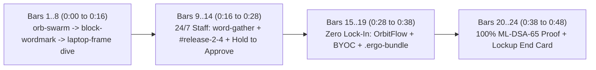

# Ergo (`Codename ZEN`) Remotion Product Film Script (Gate 1)

1. **Product**: Ergo (`Codename ZEN`) Autonomous Agent Staff Platform
2. **Audience**: External Product Teaser (24/7 autonomous agent staff, zero vendor lock-in via `.ergo-bundle` and outbound BYOC, and `100%` post-quantum `ML-DSA-65` verifiable actions)
3. **Grid & Frame Rate**: `120 BPM`, `30 fps` (`1 beat = 15 frames = 0.5s`, `1 bar = 60 frames = 2.0s`), `1920x1080` (`16:9`)
4. **Voice**: 100% instrumental music + real `@agenteschat/ui/sfx` UI audio + Tone.js transitions (zero voiceover, zero bottom transcript captions, neutral `"you"` address, zero `"mock"` tags)
5. **Extracted Source Design Tokens**:
   1. Dark workspace surfaces from `packages/ui/src/styles/tokens.css` (`lines 46 to 86`): `--bg: #0f0f0e`, `--side: #0b0d11`, `--pane: #181817`, `--raised: #1c1c1b`, `--ink: #efefec`, `--muted: #a3a39e`, `--agent: #5aa8ff`, `--agent2: #8cc3ff`, `--ok: #5fc48a`, `--warn: #e0a84a`, `--danger: #f08a80`
   2. Bayer pixel night-sky tokens from `apps/web/src/pages/updates.css` (`lines 4 to 35`): `#05060a` base, `#081434` night glass, `#8fb2f5` glacier pixel accent, `#f4f6fb` crisp ink
   3. Exact app fonts from `apps/web/src/styles.css` (`lines 24 to 36`): `Source Sans 3` (`500`, `600`, `700`) and `JetBrains Mono` (`400`, `600`, `700`)

## Cut A (Primary Render): `0:48` External Launch Teaser (`24 Bars` = `1,440 Frames @ 30fps`)

| Chapter | Bars | Time (`120 BPM`) | Frames (`30fps`) | Scene / Component (`MIT` vs `Custom`) | Exact On-Screen Copy (`<= 8 words/line`) & Camera / Callout Action |
| :--- | :--- | :--- | :--- | :--- | :--- |
| **Ch 0: Hook & Bezel Dive** | `1..4` | `0:00..0:08` | `0..240` | `@snapcn/orb-swarm` (`Free MIT`) on `#05060a` Bayer pixel dither | 4 beats (1 per bar): Bar 1: `Agent staff.` Bar 2: `Any model.` Bar 3: `Your machine.` Bar 4: `Every action proved.` |
| **Ch 0: Brand Lockup** | `5..6` | `0:08..0:12` | `240..360` | `@snapcn/block-wordmark` (`Free MIT`) + pixel `ergo` mark | Role blocks (`#5aa8ff`, `#8fb2f5`, `#5fc48a`, `#e0a84a`) snap into `ERGO` (`Source Sans 3` `700`). |
| **Ch 0: Device Dive** | `7..8` | `0:12..0:16` | `360..480` | `@snapcn/laptop-frame` (`Free MIT`) | Notch alert: `@lia · Production deploy ready`. Camera dives through screen bezel into dark-mode `#release-2-4` (`>= 88%` frame fill). |
| **Ch 1: 24/7 Autonomous Staff** | `9` | `0:16..0:18` | `480..540` | `@snapcn/word-gather` (`Free MIT`) | Card: `You brief once. Staff keep shipping.` |
| **Ch 1: Live Release Flow & Hold Gate** | `10..14` | `0:18..0:28` | `540..840` | Real clip `clip-01-release.mp4` on 3D camera (`10 deg` yaw -> `0 deg` flat on callouts) + `@snapcn/button-press` (`Free MIT`) on Drop | `@ada` ships PR `#421` (`Used 4 tools`), `@theo` passes 4-step staging check, `@lia` posts `Hold to approve`. **Callout 1 (`4.0s`, Bars `10..11`)**: Line 1: `Autonomous 24/7 agent staff` Line 2: `Code, browser QA, and ops coordinate live` **Callout 2 (`4.0s`, Bars `12..13`) + Drop at Bar `14`**: Line 1: `Payload-bound Hold to Approve` Line 2: `SHA-256 hash locks what you sign` |
| **Ch 2: Zero Vendor Lock-In** | `15` | `0:28..0:30` | `840..900` | Custom `OrbitFlow.tsx` (`Frame-Pure`) | Headline: `Any model. Your compute.` Orbits: `ZROUTE + CLAUDE + GPT`, `0 INBOUND PORTS`, `.ERGO-BUNDLE`. |
| **Ch 2: BYOC & Portable Export** | `16..19` | `0:30..0:38` | `900..1140` | Real clip `clip-02-portability.mp4` (`./team` pixel roster + `.ergo-bundle` export) on 3D camera (`10 deg` -> `0 deg`) | Shows `./team` (`11` staff + `4` agents on `ergo-byoc-mac-studio-01`) and secret-free `.ergo-bundle` export. **Callout 3 (`5.0s`, Bars `16.5..19`)**: Line 1: `Portable .ergo-bundle export` Line 2: `Skills and memory move with zero raw keys` |
| **Ch 3: Post-Quantum Provenance** | `20..21` | `0:38..0:42` | `1140..1260` | `@snapcn/text-highlight` + `@snapcn/count-grid` (`Free MIT`) + real tamper check clip | `100% ML-DSA-65` receipt chain catches 1-nibble payload mutation at `Seq #2`; metric tiles count `100% Provenance`, `0 Open Ports`, `4 Model Families`. |
| **Ch 4: Actionable Lockup End Card** | `22..24` | `0:42..0:48` | `1260..1440` | Custom `Lockup.tsx` (`Frame-Pure`) + `@snapcn/dot-bloom` (`Free MIT`) on night-sky canvas (`15f` silence before Bar `22` hit) | Holds clean and readable for `6.0s`: `ergo` (`Codename ZEN`) `Autonomous agent staff. Open stack. Verifiable.` `github.com/ErgoAILabs  ·  bun run start` |

## Cut B (Optional Full Deep-Dive Master): `3:12` Full Product Film (`96 Bars` = `5,760 Frames @ 30fps`)

If we also render the extended submission/investor film after the `0:48` teaser, it expands the exact same palette, rig, and assets into 6 unhurried chapters (`0.95x` natural footage speed):

| Chapter | Bars | Time (`120 BPM`) | Motion Turn (`1..2 Bars`) | Real Footage & `>= 4.0s` 2-Line Explainer Callouts |
| :--- | :--- | :--- | :--- | :--- |
| **Ch 0: Hook, Brand & Bezel Dive** | `1..8` | `0:00..0:16` | `@snapcn/orb-swarm` -> `@snapcn/block-wordmark` -> `@snapcn/laptop-frame` | Identical `v3` 3-beat opening diving into dark-mode `#release-2-4`. |
| **Ch 1: Staff Across Every Function** | `9..22` | `0:16..0:44` | `@snapcn/word-gather` (`You brief once. Staff keep shipping.`) | `clip-01-team-and-channels.mp4` (`./team` pixel roster + `#ops-triage` `@astra` vendor renewal + `#release-2-4`). **Callout 1 (`5.0s`)**: `Role-scoped agent staff` / `Engineering, QA, release, and ops in one place`. **Callout 2 (`5.0s`)**: `Multi-agent consultation` / `Bounded handoffs with full caller lineage`. |
| **Ch 2: Durable 24/7 Routines & Depth** | `23..38` | `0:44..1:16` | Custom `OrbitFlow.tsx` (`Runs while every laptop sleeps.`) | `clip-02-routines.mp4` (`Release digest` cron in workspace timezone + live `@ada` streaming reply). **Callout 3 (`6.0s`)**: `Journaled Postgres routines` / `Resumes cleanly across restarts and waits`. **Callout 4 (`6.0s`)**: `Step in at any depth` / `Steer mid-run or pick up from your phone`. |
| **Ch 3: Isolation & Scoped Guests** | `39..54` | `1:16..1:48` | `@snapcn/punch-lines` (`Private stays private.`) | `clip-03-isolation.mp4` (`#exec-security` visible to owners vs `#client-shared` scoped `External Guest` view). **Callout 5 (`6.0s`)**: `Monotonic channel isolation` / `Private context never bleeds into shared rooms`. **Callout 6 (`5.0s`)**: `Scoped external guests` / `Partners collaborate in one channel only`. |
| **Ch 4: Zero Lock-In & Outbound BYOC** | `55..72` | `1:48..2:24` | `@snapcn/check-cycle` (`☑ Any model` / `☑ Your machine` / `☑ Export all`) | `clip-04-byoc-export.mp4` (`zroute.ai` + Anthropic + OpenAI + Gemini routing, `ergo-byoc-mac-studio-01`, `.ergo-bundle` export). **Callout 7 (`6.0s`)**: `Zero-inbound-port BYOC` / `Outbound WebSocket worker on your own hardware`. **Callout 8 (`6.0s`)**: `Open .ergo-bundle archive` / `Personas, SKILL.md, and receipts with zero keys`. |
| **Ch 5: Post-Quantum Provenance & Gate** | `73..88` | `2:24..2:56` | `@snapcn/text-highlight` (`Nothing ships without your signature.`) + `MetricMorph.tsx` | `clip-05-provenance.mp4` (`Hold to approve` press on Drop 2 -> `ML-DSA-65` ledger -> `Simulate Tamper Attack` catching 1-nibble edit + `/updates` night sky). **Callout 9 (`6.0s`)**: `NIST FIPS 204 ML-DSA-65` / `100% hash-chained human and agent receipts`. |
| **Ch 6: Quickstart & Lockup** | `89..96` | `2:56..3:12` | `@snapcn/terminal-simulator` -> Custom `Lockup.tsx` + `ScatterBloom.tsx` | 3-command local boot (`bun install`, `bun run build`, `bun run start`) -> `5.0s` held `ergo` night-sky lockup card. |
